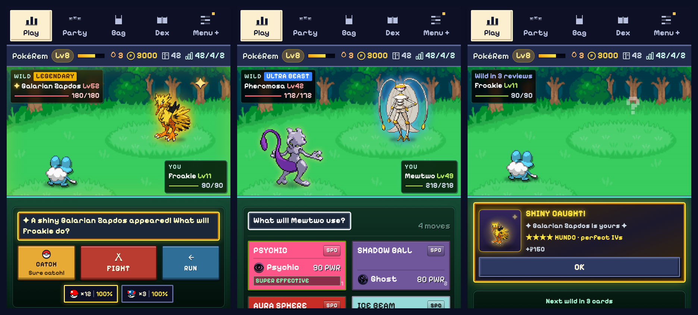
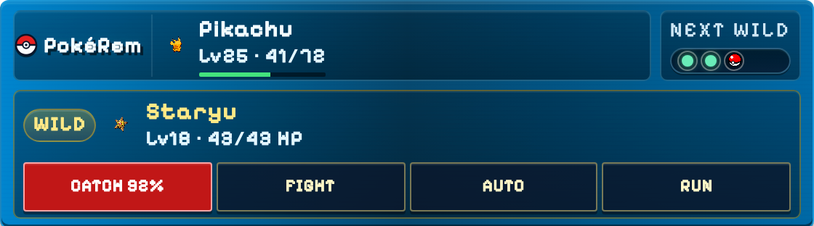
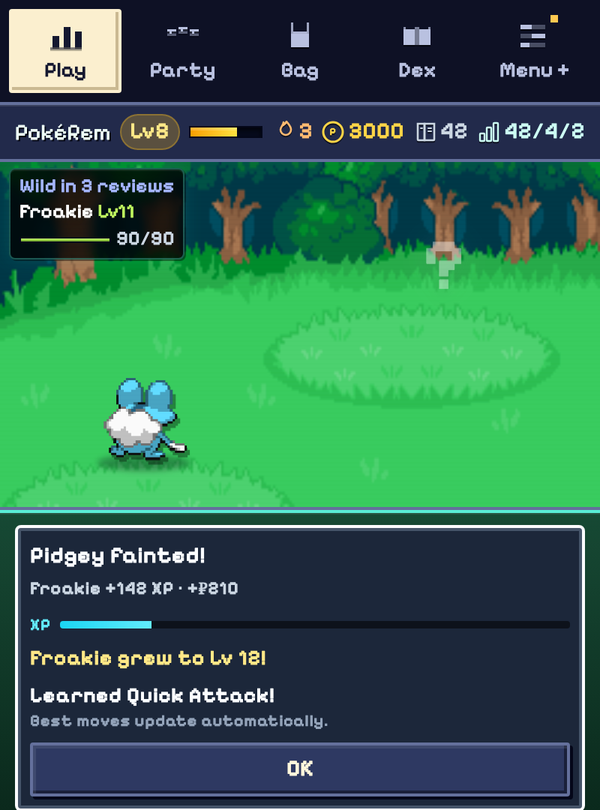
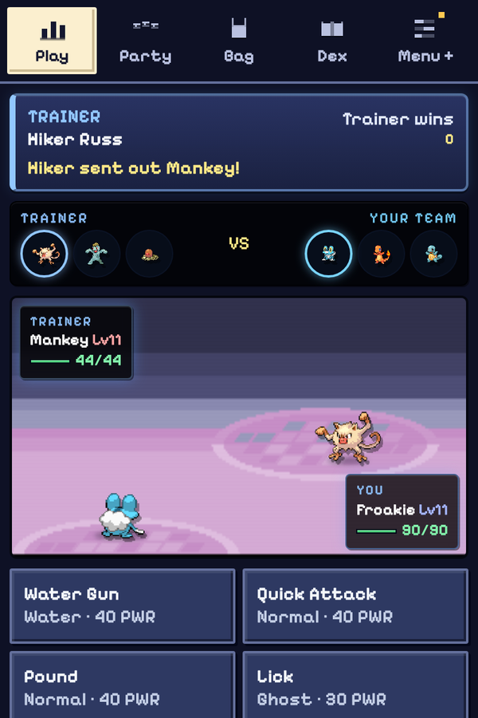
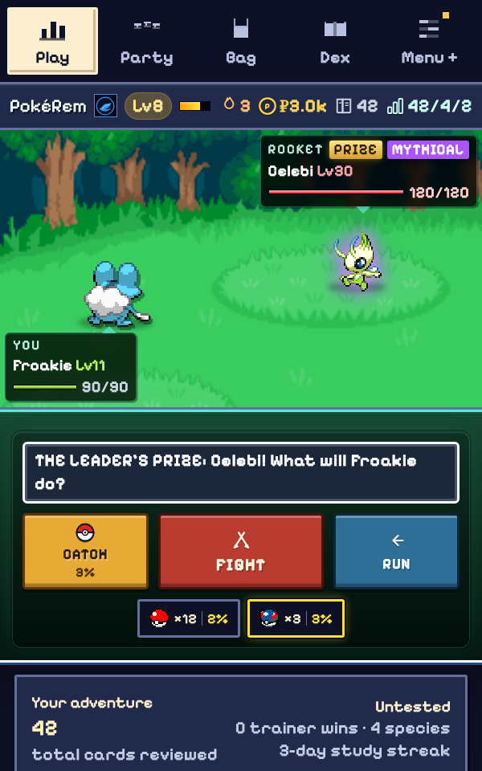
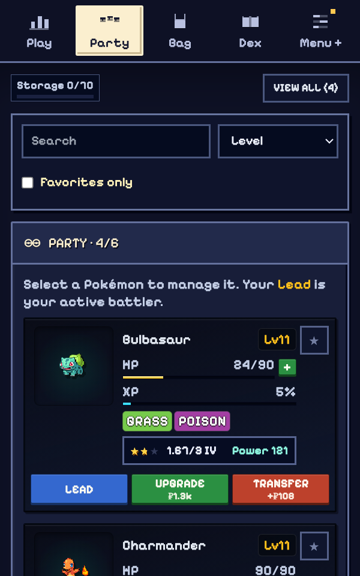
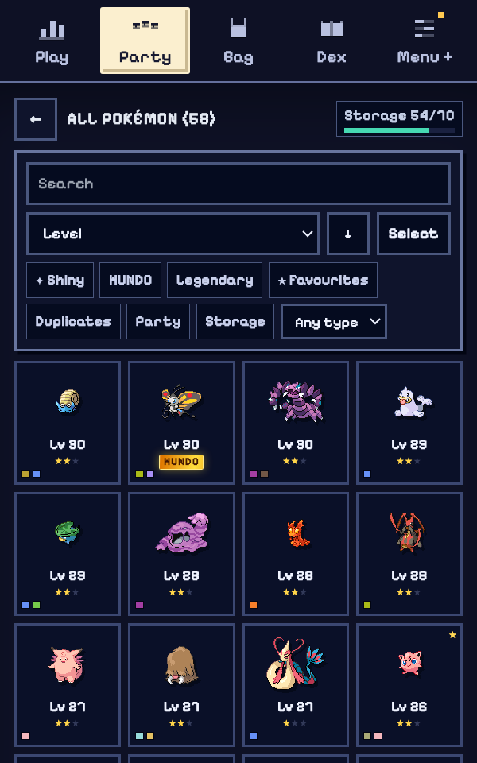
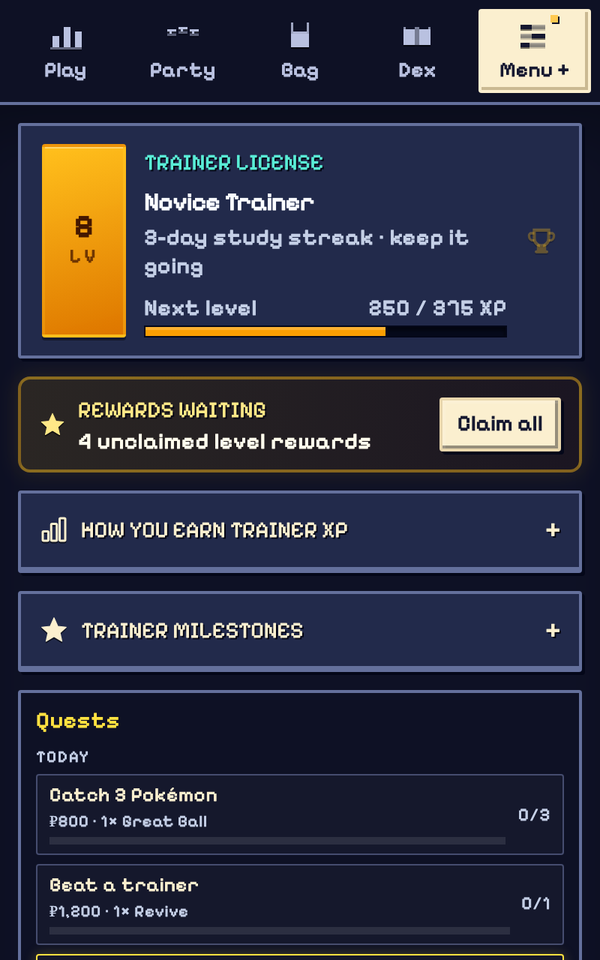

# PokéRem

**Every flashcard you review moves your Pokémon adventure forward.**

Study as you normally do in RemNote. Every few cards a wild Pokémon appears: catch it, battle it, or keep reviewing. Your team levels up as you study, evolves, learns new moves, and takes on trainers. Shinies are rare, and every one feels special.

PokéRem never touches your cards or your grades. It only rewards you for showing up and reviewing.

## Play without leaving your reviews

Catch, Fight, Auto and Run sit in a strip right above your flashcard, so you can play a full battle between cards without opening anything.

## Catch 'em as you study

- **905 Pokémon from eight generations**, appearing at sensible levels for your team. Each battle scene favours its own types: forests, caves, beaches, snowfields and more.
- **Pick your ball.** Every ball shows its live catch chance, and PokéRem suggests the cheapest good one.
- **Shiny hunting.** About 1 in 250 wild Pokémon sparkles, and a gentle safety net makes sure every regular studier meets one. Shinies get their own gold star entrance and a SHINY CAUGHT! card. Shiny legendaries are always caught with the first ball.
- **Perfect IVs.** A Pokémon with top stats earns four gold stars and a **HUNDO** badge.
- **Legendaries are special.** Galarian birds turn up about once every 250 cards, and other legendaries, mythicals and Ultra Beasts far more rarely. They're hard to catch: wear them down, use better balls and status. Team Rocket is your reliable way to get one.

## Battles that feel like the games

Classic main-series layout: "What will Mewtwo do?", moves tagged *Super effective* or *Not very effective*, smart wild and trainer foes, and a result card that fills your XP bar and shows each new level and move. Every Pokémon keeps its best four moves automatically. Auto attack weakens a wild Pokémon without knocking it out, so you can catch it.

## Trainer challenges

Themed trainers challenge you as you study, from Bug Catchers to Dragon Masters and elite trainers. Pick three Pokémon and battle 3-on-3. Win coins, items, gym badges, and a chance to catch one of their team. Lost? Heal up and rematch.

**Team Rocket** makes up about a third of your challengers. Each grunt uses one type and ends its line-up with a rare ace you can catch after winning. Beat five and the Rocket Leader appears; beat him to win a legendary that never runs away.

## Build your dream team

Your whole party levels up together with XP Share, and anyone who falls behind gets a catch-up boost. Your starter is your Buddy, with a ♥ badge and its own bonuses. Evolve, with every evolution played out in the panel. Every card has Lead, Upgrade (Power Up, evolve, Bottle Caps, Move Tutor) and Transfer, which turns spares into coins and XP. View all shows everything you own, with sort, filters and multi-select. Storage and bag space grow with your trainer level and Shop upgrades. Fill your Pokédex and keep your shinies in the Shiny Case.

Screenshots use a separate demonstration save.

## Goals for every study session

Three daily quests and two weekly ones, Special Research lines, eight gym badges, long-term achievements, daily firsts and study streaks, and a trainer license that levels up as you study. Look out for bounties and lucky cards. Join Team Ember, Tide or Volt. Spend your coins on Power Ups, 18 type themes that restyle the whole game (and boost rewards for their type), balls, potions, XP Doublers, route tickets, storage and bag upgrades and trainer card styles. Your current coins and collection carry forward when you update.

## Made for studying

- **Made to sit alongside your cards.** Ignore an ordinary wild Pokémon and it wanders off. If your lead faints, a teammate steps in. A team that's fully down rests while you study. Protected shinies, legendaries and Leader prizes wait for you to finish the encounter; your flashcard reviews remain available.
- **You set the pace.** Choose a study difficulty for how often wild Pokémon appear. Turn on Compact view to hide the arena, or reduced motion for still animations.
- **Your progress is safe.** Your save lives in your RemNote knowledge base, carries across updates, and can be exported from Settings.
- **Keyboard friendly.** C, F, A and R, plus 1–4 for moves.

## Get started

1. Install PokéRem and open RemNote's right sidebar.
2. Select the **Poké Ball** tab, or run **Open PokéRem** from the command palette (Ctrl/Cmd+K). On a fresh install PokéRem opens it for you.
3. Choose your starter and study difficulty, then review flashcards as normal.

Use **Play** for battles, **Party** for your team, **Bag** for items and the shop, and **Dex** for your collection. **Menu** opens the Trainer screen, type chart and Settings.

**Don't see the Poké Ball?** PokéRem runs on RemNote desktop and web, not the mobile apps. Check that it's switched on under Settings → Plugins, then reload RemNote. A console message saying `snippet.css` returned 403 is harmless. If the tab still doesn't appear, please [open an issue](https://github.com/jostneilson/pokerem-remnote-plugin/issues).

Pokémon sprites load from the internet. Item icons, battle backgrounds and fonts are bundled. No audio.

## Support and feedback

Found a bug or have an idea? [Open an issue](https://github.com/jostneilson/pokerem-remnote-plugin/issues). See what changed in each version in the [changelog](https://github.com/jostneilson/pokerem-remnote-plugin/blob/main/CHANGELOG.md).

Enjoying your study adventure? [Support PokéRem on Ko-fi](https://ko-fi.com/pokerem).

## Credits

PokéRem is an unofficial fan project and is not affiliated with Nintendo, Game Freak, or The Pokémon Company. Pokémon and related names belong to their respective owners. See [attribution and asset credits](https://github.com/jostneilson/pokerem-remnote-plugin/blob/main/ATTRIBUTION.md) and the [project repository](https://github.com/jostneilson/pokerem-remnote-plugin).
